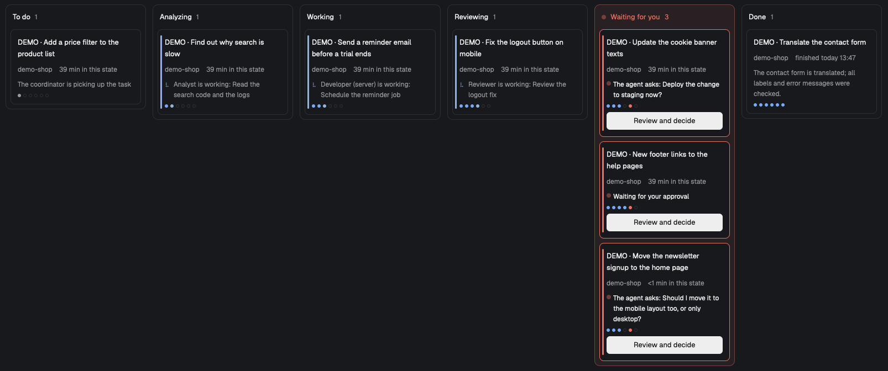

# Kanban for Herdr

[Slovensky](README.sk.md)

A kanban board for tasks you hand to AI coding agents, as a [Herdr App](https://herdr.dev) mod. Write what you want
done, pick a project, and follow the card as the agent works:

**To do → Analyzing → Working → Reviewing → Waiting for you → Done**

When the agent needs you, the card moves to **Waiting for you**: read its plain-language summary and press
**Approve**, **Send back with a comment**, or **Answer** its question, without reading a terminal. The **Technical
details** toggle shows the agents, roles, models, activity log and handback files behind each card. The board is in
English or Slovak.



> **Status: beta (0.1.0).** Built and used daily by one person. See [Tested with](#tested-with) for what has and has
> not been tried.

## How it works

- The board reads only **labels** on herdr-core terminals (`team=<key>`, `team.phase=build`, …), plus each
  terminal's status and screen. The [label contract](docs/label-contract.md) is the whole interface.
- **+ New task** starts your agent in the chosen project folder through `hc run`, with a command you can change in
  **Settings** (default `claude "/kanban-team {task}"`).
- The companion skill [`kanban-team`](skills/kanban-team/SKILL.md) teaches the agent to set the labels: phases, asking
  for approval, a summary for you, optional helper agents, finishing. Any agent, skill or script that sets the same
  labels works too.

## Requirements

- Herdr App with herdr-core (`hc` on your `PATH`).
- An agent CLI for **+ New task**. The default command uses [Claude Code](https://claude.com/claude-code) (`claude`).
  Anything else works if you change the command (see [Settings](#settings)).

## Install

1. **Copy the mod** into your Herdr app folder (`~/.config/herdr-app`, or `$HERDR_APP_HOME` if you set it) as
   `mods/kanban`. The mod finds its settings at `mods/kanban/settings.json`.

   ```sh
   git clone https://github.com/sokactomas/herdr-kanban
   mkdir -p ~/.config/herdr-app/mods
   cp -R herdr-kanban/mods/kanban ~/.config/herdr-app/mods/
   herdr-app check ~/.config/herdr-app/mods/kanban     # → check passed
   ```

   **Already have a mod called `kanban`?** Don't overwrite it; install this one under another name (Herdr does not
   tell a mod its own folder, so the name is one constant in `main.js`):

   ```sh
   mkdir -p ~/.config/herdr-app/mods
   cp -R herdr-kanban/mods/kanban ~/.config/herdr-app/mods/<name>
   # in ~/.config/herdr-app/mods/<name>/main.js change  const MOD = "kanban";  to  const MOD = "<name>";
   herdr-app check ~/.config/herdr-app/mods/<name>
   ```

   Then use `"mod": "<name>"` in the key below. Its settings live in `mods/<name>/settings.json` and its stored state
   under `<name>.state`. Don't use `herdr-app do mod.clone` for this: it copies the mod already installed as `kanban`.

2. **Add a key** to open the board as a tab. Merge the repo's [`keys.json`](keys.json) into the `"global"` section
   of `~/.config/herdr-app/keys.json` (keep your other keys; pick another key if `cmd-shift-k` is taken; on Linux and
   Windows use e.g. `ctrl-alt-k`):

   ```json
   { "global": { "cmd-shift-k": { "command": "tab.new", "args": { "name": "Kanban", "mod": "kanban" } } } }
   ```

   Without a key: `herdr-app do tab.new --name Kanban --mod kanban`.

3. **Install the skill** for your agent (only needed with the default command):

   ```sh
   # Claude Code
   mkdir -p ~/.claude/skills && cp -R herdr-kanban/skills/kanban-team ~/.claude/skills/
   ```

   Other agents: put `skills/kanban-team/SKILL.md` wherever your agent reads skills or instructions from, or paste it
   into the brief. It is plain Markdown with shell commands.

   **Agent permissions.** The agent runs without a pane, and the skill calls `hc` often. If every call asks for
   permission, each prompt sends the card to **Waiting for you**. In Claude Code, allow these in your settings
   (`permissions.allow`) or start it in a mode that allows them: `Bash(hc label:*)`, `Bash(hc get:*)`,
   `Bash(hc run:*)`, `Bash(hc wait:*)`, `Bash(hc send:*)`. Other agents: the same `hc` subcommands.

4. **Optional demo**: `~/.config/herdr-app/mods/kanban/demo/start-demo.sh <a project folder>` puts one DEMO card in
   every column; `demo/stop-demo.sh` removes them. Pick the folder of an open Herdr space so the cards show its name.

You can also ask an agent running inside Herdr: *"Install the Herdr mod from https://github.com/sokactomas/herdr-kanban"*.
The repo follows Herdr's layout for shared mods (`mods/kanban/`, a root `keys.json`, `RECIPE.md`, `preview.png`), so
Herdr's own agent guide tells it how to copy the mod, merge the key and check it.

**Update**: copy the new `mods/kanban` over the old one. Your `settings.json` is not in the repo, so it stays.

## Use

1. Press your key (e.g. ⌘⇧K). The **Kanban** tab opens; with nothing running you see six empty columns.
2. **+ New task**: under **What should the team do?** describe the work (free text, a ticket key or a link), pick a
   **Project** (one per Herdr space), then **Give it to the team**. The card appears in **To do** at once and the
   agent starts in that folder.
3. Follow the card. Each card shows the goal, the project, how long it has been in this column, one line of what is
   happening now and progress dots. A working card has a spinner; a waiting card a calm pulse and a
   **Review and decide** button.
4. **Waiting for you**: open the card, read **Summary** and **Agent's question**, then
   - pick an option or type an answer (**Answer**), or
   - **Approve**, or **Send back with a comment** (type it, then **Send**).
5. **Done** shows the last 7 days; older cards are behind **Show older**. A run that ended before it finished is
   marked **Interrupted**.

The agent started from the board has no pane of its own: turn on **Technical details** and press **Go →** to see its
terminal. Its first screen may be your agent's "trust this folder?" dialog; it shows in **Waiting for you** and
**Answer** handles it.

If more than one project has tasks, a project filter (**All projects**, then each project) appears under the toolbar.

## Settings

Press **Settings** on the board's toolbar: **Language** (English / Slovenčina) and **Command that starts a task**
(the **Default: …** button under it puts the default back), then **Save**. Or edit the file by hand; it is
`~/.config/herdr-app/mods/kanban/settings.json` (`$HERDR_APP_HOME/mods/kanban/settings.json` if you set that).
Either way the change applies at once: saving any file in the mod folder reloads the mod.

```json
{ "locale": "en", "command": "claude \"/kanban-team {task}\"" }
```

| Key | Default | Meaning |
|---|---|---|
| `locale` | `en` | a two-letter code with an `i18n/<code>.js`: `en` or `sk` today (`pt-br` is read as `pt`); missing or unknown → English |
| `command` | `claude "/kanban-team {task}"` | what **+ New task** runs in the project folder; missing or empty → the default |

The command is a string split like a shell (spaces, `"double"` and `'single'` quotes, backslash escapes), or a JSON
array of words. **No shell runs it**: the placeholders are filled inside each word after splitting, and the board
starts the words through `env` (`hc run … -- env <words…>`), so even a one-word command never reaches a shell. The
task text is always exactly one argument, whatever quotes, backticks or `$(…)` it contains. The activity of a new card
shows the exact words it started. Placeholders:

| Placeholder | Filled with |
|---|---|
| `{task}` | the task text you typed |
| `{key}` | the card's key, e.g. `abc-123` or `task-k3f9` |
| `{project}` | the project (Herdr space) name |
| `{folder}` | the project's folder |

Examples: `claude "/my-own-skill {task}"`, `codex --cd {folder} -- {task}`, `["aider", "--message", "{task}"]`, or
a script of yours that sets the labels itself. Put `--` before a bare `{task}` when your program accepts it, so a task
that starts with `-` is not read as an option. A file with invalid JSON is ignored (defaults apply).

The board also remembers, per viewer in its local storage: the last language (`kanban.locale`, so the first frame is
already in it), **Technical details** on/off (`kanban.tech`) and the project filter (`kanban.project`).

### Adding a language

Copy `mods/kanban/i18n/en.js` to `i18n/<code>.js` (a two-letter code), translate the values (keep the keys and the
function arguments), and add two lines to `main.js`: `import XX from "./i18n/xx.js"` and `xx: XX` in `LOCALES`. Pull requests welcome.

## Plug in your own agent or script

The board does not care what does the work. Anything that sets the labels from the
[label contract](docs/label-contract.md) on a herdr-core terminal gets a card. Try it by hand in any Herdr terminal:

```sh
hc run --bg --no-parent --name try-lead --label team=try --label team.lead=1 \
  --label "team.goal=Try the board" --label team.demo=1 -- sh -c 'sleep 3600'
hc label try-lead team.dir=/tmp team.phase=build                              # → Working
hc label try-lead "team.summary=Looks good, please approve" team.approval=1   # → Waiting for you
hc label try-lead team.approval= team.phase=done                              # → Done
hc kill try-lead; hc rm try-lead
```

`team.demo=1` marks the card as demo data ("DEMO · " in front of the title, dropped once the terminal is gone, so the
last line removes the card). [RECIPE.md](RECIPE.md) describes the demo scripts and the labels for one card in each
column.

When you press **Approve**, the agent receives the message `Approved, go on.`; **Send back with a comment** sends
`Sent back: <your comment>` (Slovak board: `Schválené, pokračuj.` / `Vrátené: <comment>`). Your agent or script should
understand those.

## What it does on your machine

- **Runs programs**: your command through `hc run`, only when you press **Give it to the team**.
- **Types into terminals**: **Approve** / **Send back with a comment** send text to the run's lead; **Answer** presses
  keys or sends text to the terminal that asks. Only on your click, and an option is pressed only after re-reading
  the screen and finding the same option. Text always goes after `--` (`hc send <t> -- <text>`), so an answer that
  starts with `-` is sent as text; a typed answer stays in its field until it was sent.
- **Reads local files** that a `team.out` label names (handback files), to show their result line. Opening one never
  runs it: macOS reveals it in Finder (`open -R`), Windows selects it in Explorer, Linux opens its folder.
- **Writes one file**: its own `mods/kanban/settings.json`, when you press **Save** in **Settings**.
- **No network.** Links (**Preview ↗**, **Code changes ↗**, the ticket) open in your browser, and only when they are
  `http(s)` URLs; anything else is shown as plain text, not clickable.
- Keeps its card history in Herdr's shared mod state (key `kanban.state` in `shared.json`). Finished runs are kept a
  month after their last activity, at most 40 runs.

## Tested with

- Herdr App 0.1.18, herdr-core (`hc`) 0.1.22, Claude Code 2.1.332, on macOS.
- `herdr-app check` passes for the mod in a fresh Herdr app folder.
- The demo scripts (one card per column), the New task command splitting and placeholders, and answering Claude
  Code's question dialog (numbered options and free text) and its folder-trust dialog.
- The board's columns, detail, Approve / Send back and Answer, with real tasks driven by the author's own skill that
  follows the same label contract (in the board's previous, private version).

**Not tested** (reports welcome):

- The bundled `kanban-team` skill end to end. It is new in 0.1.0 and written from the label contract.
- This public version clicked through in a running window (Settings save, language switch on screen).
- Linux. Windows: starting a task needs `env` (the board launches `env <words…>`), which Windows does not have, so
  **+ New task** is expected to fail there; the rest of the board is untested.
- Agents other than Claude Code. Labels and plain-text answers should work; their question dialogs may not be shown
  as option buttons.
- Runs on other machines (`hc run --on`), and spaces whose folder is remote.
- Herdr / hc versions other than the ones above. Answering dialogs reads the agent's screen and depends on how it
  draws them.
- Many runs at once (it was used with a handful).

## FAQ

**Do I need Jira, GitLab or GitHub?** No. A task is free text. If the agent labels a ticket (`team.ticket`), a code
change (`team.mr`) or a preview (`team.preview`), or the task text contains a link, the card shows them as links.

**A card stays in To do.** The agent has not taken it over: it never set `team.dir` (or a later phase) and started no
helper. Check that the skill is installed for your agent and that the command starts it (**Technical details** →
**Go →** shows its terminal).

**Why is a card in Waiting for you?** Something in that run reports `blocked` (a question, a permission prompt, an
error), someone set `team.approval=1`, or the lead stopped with a last screen line ending in `?`.

**Can I use my own skill instead of `kanban-team`?** Yes. Set the command in **Settings** to start it and have it
follow the [label contract](docs/label-contract.md). `kanban-team` is a short example of doing that.

**Does it change how my agent works?** No. Labels only feed the board. The skill asks the agent to set labels and to
ask you before risky steps; your agent's own permissions and rules still apply.

## Uninstall

```sh
rm -rf ~/.config/herdr-app/mods/kanban    # the mod and your settings.json
rm -rf ~/.claude/skills/kanban-team       # if you installed the skill
```

Remove the key from `~/.config/herdr-app/keys.json`. The card history (`kanban.state` in Herdr's `shared.json`) stays
behind; it is harmless and nothing reads it once the mod is gone.

## License

[MIT](LICENSE)
