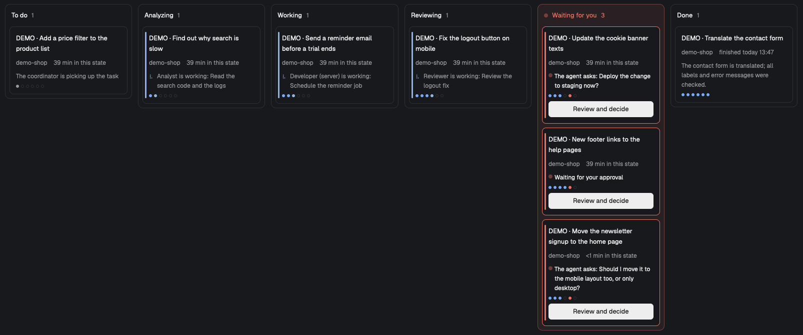

# Kanban pre Herdr

[English](README.md)

Kanban pre úlohy, ktoré zadávaš AI agentom, ako mod pre [Herdr App](https://herdr.dev). Napíšeš, čo treba urobiť,
vyberieš projekt a sleduješ kartu, ako agent pracuje:

**Zadané → Analyzuje sa → Pracuje sa → Kontroluje sa → Čaká na teba → Hotovo**

Keď agent potrebuje teba, karta prejde do **Čaká na teba**: prečítaš si zhrnutie v ľudskej reči a stlačíš
**Schváliť**, **Vrátiť s komentárom** alebo **Odpovedať** na jeho otázku, bez čítania terminálu. Prepínač
**Detail pre technika** ukáže agentov, roly, modely, záznam aktivity a súbory s výsledkami. Board je po anglicky
alebo po slovensky.



> **Stav: beta (0.1.0).** Testované s Herdr App 0.1.18, herdr-core (`hc`) 0.1.22 a Claude Code 2.1.332 na macOS.
> Netestované: Linux, Windows, iní agenti než Claude Code, behy na iných strojoch, priložený skill `kanban-team` od
> začiatku do konca. Podrobnosti v [anglickom README](README.md#tested-with).

## Ako to funguje

- Board číta len **labely** terminálov herdr-core (`team=<kľúč>`, `team.phase=build`, …) a stav a obrazovku
  terminálu. Celé rozhranie je [kontrakt labelov](docs/label-contract.md) (anglicky).
- **+ Nová úloha** spustí cez `hc run` tvojho agenta v priečinku projektu príkazom, ktorý si nastavíš tlačidlom
  **Nastavenia** (predvolený `claude "/kanban-team {task}"`).
- Skill [`kanban-team`](skills/kanban-team/SKILL.md) naučí agenta labely nastavovať. Funguje aj akýkoľvek iný agent,
  skill alebo skript, ktorý nastaví tie isté labely.

## Inštalácia

Mod sa inštaluje ako `mods/kanban` (nastavenia hľadá v `mods/kanban/settings.json`). Ak už máš mod `kanban`,
skopíruj ho ako `mods/<názov>` a v jeho `main.js` zmeň `const MOD = "kanban";` na `const MOD = "<názov>";`
(postup v [anglickom README](README.md#install)); `herdr-app do mod.clone` na to nepoužívaj.

```sh
git clone https://github.com/sokactomas/herdr-kanban
mkdir -p ~/.config/herdr-app/mods
cp -R herdr-kanban/mods/kanban ~/.config/herdr-app/mods/
herdr-app check ~/.config/herdr-app/mods/kanban     # → check passed
mkdir -p ~/.claude/skills && cp -R herdr-kanban/skills/kanban-team ~/.claude/skills/   # skill pre Claude Code
```

Potom pridaj klávesu z [`keys.json`](keys.json) v repe do sekcie `"global"` v
`~/.config/herdr-app/keys.json` (ostatné klávesy nechaj tak; ak je `cmd-shift-k` obsadená, vyber inú). Bez klávesy:
`herdr-app do tab.new --name Kanban --mod kanban`.

Ukážka: `~/.config/herdr-app/mods/kanban/demo/start-demo.sh <priečinok projektu>` dá do každého stĺpca jednu DEMO
kartu, `demo/stop-demo.sh` ich odstráni.

**Aktualizácia**: skopíruj nový `mods/kanban` cez starý. Tvoj `settings.json` v repe nie je, takže ostane.

## Nastavenia

Tlačidlo **Nastavenia** na boarde: **Jazyk** (English / Slovenčina) a **Príkaz, ktorý spustí úlohu**
(tlačidlo **Predvolený: …** pod ním vráti predvolený), potom **Uložiť**. Alebo uprav súbor `~/.config/herdr-app/mods/kanban/settings.json`
ručne; zmena platí hneď.

```json
{ "locale": "sk", "command": "claude \"/kanban-team {task}\"" }
```

- `locale`: dvojpísmenový kód, `en` (predvolený) alebo `sk`.
- `command`: predvolený `claude "/kanban-team {task}"`. Nespúšťa sa cez shell (board ho štartuje cez `env`): text
  úlohy je vždy jeden argument, nech obsahuje čokoľvek.
  Zástupné znaky: `{task}` text úlohy, `{key}` kľúč karty, `{project}` názov projektu, `{folder}` jeho priečinok.

Tlačidlo **Schváliť** pošle agentovi správu `Schválené, pokračuj.`, **Vrátiť s komentárom** pošle
`Vrátené: <komentár>` (v anglickom boarde `Approved, go on.` / `Sent back: <comment>`).

## Čo robí na tvojom počítači

- Spúšťa tvoj príkaz cez `hc run`, len keď stlačíš **Zadať tímu**.
- Píše do terminálov len po tvojom kliknutí (**Schváliť**, **Vrátiť s komentárom**, **Odpovedať**).
- Číta lokálne súbory, ktoré určí label `team.out`; nikdy ich nespúšťa, len ukáže vo Finderi / správcovi súborov.
- Odkazy otvára v prehliadači, len ak sú `http(s)`.
- Zapisuje len svoj `mods/kanban/settings.json`, keď v Nastaveniach stlačíš **Uložiť**.
- Nič neposiela po sieti. História kariet je v zdieľanom stave Herdru (kľúč `kanban.state`).

## Odinštalovanie

```sh
rm -rf ~/.config/herdr-app/mods/kanban ~/.claude/skills/kanban-team
```

a odober klávesu z `keys.json`. Kľúč `kanban.state` v `shared.json` ostane; je neškodný.

## Licencia

[MIT](LICENSE)
