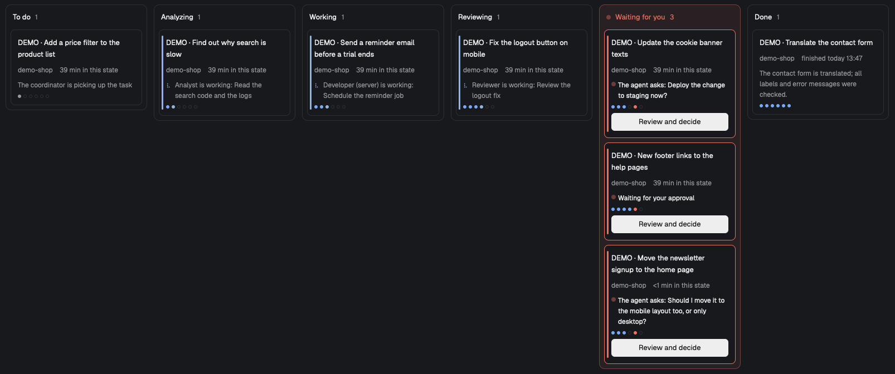

# Kanban

A kanban board for tasks you hand to a team of coding agents. You write a task, pick a project, and the board starts a
coordinator agent for it; the card then moves through **To do → Analyzing → Working → Reviewing → Waiting for you →
Done** while the team works. When the team needs you, the card says so in plain words, shows the team's summary and the
agent's question, and lets you **Approve**, **Send back with a comment** or **Answer** without opening a terminal. A
"Technical details" switch shows the members, their roles, models, effort, activity log and handback files.
It reads only herdr-core labels, so any agent or skill that follows the label contract (`docs/label-contract.md`) gets a
board.



The mod is `mods/kanban/`; `keys.json` here binds it to a key. Paths below are inside `mods/kanban/` unless they start
at the repository root.

## What you see

- **Toolbar**: the heading "Kanban" and one line of explanation; on the right the "Technical details" check (14 px box, accent
  when on, kept per viewer in `localStorage` `kanban.tech`), a "Settings" button and a filled "+ New task" button
  (32 px). Below, when tasks come from more than one project, a segmented project filter ("All projects", then each
  project; kept in `localStorage` `kanban.project`).
- **Board**: six columns (12 px gap, each at least 208 px; narrower windows scroll sideways), each a rounded (10)
  `surface` box with a 1 px `border`, a header with label and count. **Waiting for you** stands out: `blocked` tint at
  8 %, its border at 40 %, label and count in `blocked`, and a calmly pulsing 8 px dot (opacity 0.4–1, 1.8 s) while it
  holds cards. Empty columns say "Nothing yet." (To do: "Click “New task” …", Waiting for you: "Nothing is waiting for
  you."). Done shows the last 7 days; older cards hide behind "Show older (n)".
- **Card** (rounded 8, 1 px border): the goal (13 px semibold; "DEMO · " first for demo runs); project · time in this
  column (Done: "finished today 14:02", or a `blocked` "Interrupted" tag and "ended …"); one line of what is happening now
  in plain words; six 6 px progress dots. Working: 3 px accent stripe and the braille spinner. Waiting: `blocked`
  border and stripe, a pulsing dot, and a full-width filled **Review and decide** button.
- **Detail** (right column, 380 px; a card click opens it, again closes it): the column as a tinted pill, time in it, ✕;
  goal, project and when it was created.
  - Waiting for you: a tinted callout, **Summary** (team summary, else the coordinator's last message) with links
    (Preview, Code changes, ticket; http(s) links only, anything else shows as plain text), **Agent's question**: one box per thing it waits on: who asks, the question, the
    dialog's options as full-width rows (number, label, description) or an answer field + **Answer** (both when the
    dialog has a free-text option); then **Approve** and **Send back with a comment** (opens a comment field). While the
    coordinator itself sits in a dialog, those two are disabled with a note.
  - Other columns: **What is happening now**, the Interrupted note, **Summary**.
  - Always: **Progress** (six steps with when the card entered each) and **Activity** (your actions and the column
    moves).
- **New task** (right column): "What should the team do?" (5 rows), **Project** pills (one per Herdr space folder,
  the shown space preselected), a hint, **Give it to the team** / **Cancel**.
- **Settings** (right column): **Language** (one item per file in `i18n/`), **Command that starts a task** (with the
  placeholders and a "Default" reset), where it is saved, **Save** / **Cancel**.
- **Technical details** on: under the board, the open task's technical view (goal, key, step, running time, active
  members, "Right now" rows, a 7-step stepper, a member board); the detail column gets a "Task | Team activity" switch
  (activity log with a member filter, or a member's detail with Go / Reply).

## The look

- Colours from `theme()` only, so light and dark themes both work; the only fixed colours are the four role-group hues of
  the technical view (`ROLE_HUE`). Tints are theme colours with an alpha byte. Primary buttons: `solid` /
  `solid_foreground`.
- The UI font in 12 / 13 / 15 px, weights 400 / 500 / 600; spacing 4 / 8 / 12 / 16 / 24.
- Motion is native only (`frames`, `loop`, `transition`) and stops while the board isn't drawn: the braille spinner
  (100 ms) on working things only, a calm opacity pulse on needs-you dots, activity entries in the technical log slide
  in once. No moving lines; at most one moving thing per card.

## How it behaves

- **Column of a task** (`columnOf`):
  1. **Waiting for you** wins while the run is running and something waits on the person: a live member or the lead
     `blocked` (a question, permission or trust dialog, an error), anyone labelled `team.approval=1`, or the lead
     stopped and its last screen line ends with "?".
  2. **Done**: the lead's `team.phase=done`, or the run ended (ended before done = Done · Interrupted).
  3. **To do**: started from the board and no coordinator terminal yet, or a lead with no `team.dir`, no helpers and
     phase intake.
  4. Else by the lead's phase: intake / plan → **Analyzing**, build → **Working**, review / integrate → **Reviewing**.
- **New task → Give it to the team**: the card shows in To do at once, then the board runs
  `hc run --json --bg --no-parent --name <key>-lead --cwd <project folder> [--on <machine>] --label team=<key>
  --label team.lead=1 --label "team.goal=<first line, ≤60 chars>" --label team.phase=intake -- env <command>`, where
  `<command>` is the setting split like a shell (quotes, backslashes) with `{task}`, `{key}`, `{project}`, `{folder}`
  filled in each word afterwards. `env` is always first because hc runs a single word through `sh -c`; `env` executes
  the words as given, so no shell runs and the task text is always one argument. The task's activity shows the exact
  argv ("Started: [...]"). The key is a ticket key found in
  the text (`ABC-123` → `abc-123`), else `task-xxxx`; taken keys or names get `-2`, `-3`. A failed start toasts the
  error and the card goes to Done · Interrupted; a start whose terminal never appears ends after 2 minutes.
- **The coordinator renames its run** (`team=<other key>` on the same terminal): the card follows it. A new run on a key
  a finished run used moves the old card to `<key>~2`.
- **Approve** sends the dictionary's `approveMsg` ("Approved, go on.") to the lead with `hc send <lead> -- <text>`, then removes
  `team.approval` from the run's terminals and clears a plain-text question. **Send back** sends `returnedMsg`
  ("Sent back: <comment>").
- **Answer** goes to the member that asks:
  - an option: the screen is read again and the same option must still be there; then a numbered option's digit
    (`hc keys <t> 2`), or for an unnumbered list the arrows from the ❯ cursor and Enter;
  - text: into the dialog's "Type something." option when it has one (its digit, then `hc send --force`), else
    `hc send <t> -- <text>` (`--force` when the program is blocked: the person is the one answering). The `--` lets an
    answer start with "-". Typed answers and comments stay in their field until the send succeeded.
  Verified with Claude Code 2.1.332: digits pick question options, ↓ + Enter answers the folder-trust dialog, the
  free-text option followed by `hc send --force` delivers text.
- Every action shows a toast and is written to the task's activity; buttons are disabled while their hc call runs.
- Activity entries are stored as data (`{ at, kind, who, d }`) and turned into text when shown, so switching the language
  translates the history too.
- Screens are read (`hc read --lines 80`) once per member status and question, and the open task's questions again once
  a minute; that minute timer also refreshes the times. No other timers.
- **Demo runs** (`team.demo=1` on any terminal of the run, or a `kanban-demo-…` key): "DEMO · " before the title, shown
  in their column like any run (a done demo in Done), and dropped from the board's state once none of their terminals is
  live.
- **Props**: `{ open: "<team key>" }` opens that task; `{ member: "<address>" }` opens its task with Technical details
  and that member; `{ forget: ["<team key>"] }` drops those runs.
- Finished runs are kept a month after their last activity, at most 40 runs. A run whose terminals are still live is
  never dropped (it would only come back on the next sync).
- **Links**: preview, code changes and ticket open only http(s) URLs in the browser. A handback file (`team.out`) is never
  opened or run: if it is a readable file it is revealed in the file manager (macOS `open -R`, Windows
  `explorer.exe /select,<file>`, Linux `xdg-open <its folder>`).

## Settings

`mods/kanban/settings.json` in the Herdr app's folder (`~/.config/herdr-app`, or `$HERDR_APP_HOME`), written by the
Settings panel, or by hand:

```json
{ "locale": "en", "command": "claude \"/kanban-team {task}\"" }
```

- `locale`: a language code with a file in `i18n/` (`en`, `sk`); anything else is English.
- `command`: a string (split like a shell) or an array of words (`["aider", "--message", "{task}"]`); placeholders
  `{task}` `{key}` `{project}` `{folder}`. Missing or empty: the default above.
- The file is not shipped, so copying a new version of the mod over the folder keeps it. Saving it (from the panel or
  an editor) reloads the mod, which applies it.
- Another folder name: Herdr doesn't tell a mod its own folder (`import.meta` is empty), so the name is one constant,
  `const MOD = "kanban"` near the top of `main.js`. To install as `mods/<name>/`: copy the folder there, set
  `MOD = "<name>"` (it names the settings file and every stored key: `<name>.state`, `<name>.tech`, `<name>.project`,
  `<name>.locale`), and use `"mod": "<name>"` in the key binding. `mod.clone` is not a way to do it (it copies the mod
  already installed under that name).

## Built from

- **Files**: `mods/kanban/`: `main.js`, `i18n/en.js`, `i18n/sk.js`, `mod.json` (`"place": "none"`, title "Kanban"),
  `demo/`. Repository root: `keys.json` (the key binding), `RECIPE.md`, `preview.png`.
- **gpui-base**: `TextareaState` / `Textarea` (task, comment), `InputState` / `Input` (answer, command), created in
  `init`, released in `close()`.
- **herdr**: `terminals`, `agents`, `spaces` + `panes` (projects), `hc` (`run`, `send`, `keys`, `label`, `read`), `run`
  (`agent.focus`, `space.select`, `terminal.peek`), `readTextFile` / `writeTextFile` (settings, handback files),
  `exec` (only to reveal a handback file in the file manager), `notify`, `shared` / `setShared` (`kanban.state`), `theme`,
  `settings`, `home`, `appHome`, `checking`, `window().platform`, `props`, `localStorage`.
- **Programs it starts**: the configured command, through `hc run`, only when the person clicks "Give it to the team".
- No network (links open in the browser).

## Watch out

- It types into terminals: Approve / Send back send text to the lead; Answer presses keys or sends text to the asking
  member, `--force` past a blocked status. Only on a click, and an option is pressed only after re-reading the screen.
- It reads any local file a `team.out` label names (to show its result line and before revealing it), and runs the
  command in settings.json (through `env`, never a shell).
- A coordinator started from the board has no Herdr pane (no parent terminal); reach it through Technical details → Go
  (peek). Its first screen in a new folder may be the agent's folder-trust dialog: it shows in Waiting for you and
  Answer handles it.
- "The lead asks in plain text" is a heuristic: its last meaningful screen line ends with "?".
- The screen reading knows Claude Code's frame and dialogs; other agents work through labels and plain-text prompts,
  their dialogs may not be parsed into options (the answer field still works).
- `herdr-app check` warns about stranded tasks after its reload; a check artefact, not a failure.
- Tested with Herdr App 0.1.18, herdr-core (`hc`) 0.1.22, Claude Code 2.1.332, on macOS.

## How to test

`mods/kanban/demo/start-demo.sh [project folder]` starts twelve small `sh` / `bash` terminals (they only print and read) that put one
DEMO card in every column: To do, Analyzing (researcher working), Working (backend working), Reviewing (critic
working), Waiting for you three ways (a dialog with options, an approval with a summary, a plain-text question), Done.
`demo/stop-demo.sh` ends and removes them; their cards go with them. `demo/demo.sh` reports an OSC 7501 state
(`printf '\033]7501;state=%s\007'`) and echoes what it is sent; `demo/dialog.sh` imitates a choice dialog
(`state=blocked:kind=question:msg=<base64>`; the msg must be base64).

## Done when

- `herdr-app check mods/kanban` passes, also from a fresh `HERDR_APP_HOME`.
- With a done demo run live, 3 syncs in a row write shared state 0 times after the first, and its card shows in Done.
- With no labelled terminals, the board shows six empty columns and the To do hint.
- `start-demo.sh` puts a DEMO card in each column; Waiting for you is tinted and its cards show "Review and decide";
  `stop-demo.sh` removes them all.
- New task starts `<key>-lead` with the labels above and the configured command; the card shows in To do at once.
- Answer on the dialog demo prints "Picked: 2"; on the plain question it prints "Received: …"; Approve prints
  "Received: Approved, go on." and the card leaves Waiting for you; each action toasts and shows in Activity.
- Switching the language in Settings changes every text, the activity history included.
- `grep -E "#[0-9a-fA-F]{6}" main.js` finds only `#00000000` and the eight `ROLE_HUE` values.
